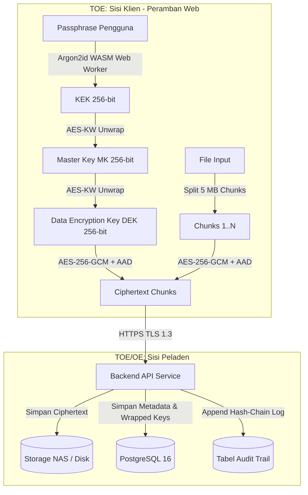

# PRODUCT REQUIREMENT DOCUMENT (PRD)
# SECURE VAULT: ZERO-KNOWLEDGE ENCRYPTED CLOUD VAULT

---

| **Informasi Dokumen** | **Spesifikasi** |
| :--- | :--- |
| **Nama Proyek** | Secure Vault |
| **Klasifikasi Proyek** | Aplikasi Brankas Berkas Terenkripsi Sisi-Klien (Zero-Knowledge) |
| **Institusi / Konteks** | Pusat Sertifikasi Teknologi Keamanan Siber dan Sandi — BSSN |
| **Status Dokumen** | Baseline Final MVP (Versi 1.0) |
| **Standar Acuan** | ISO/IEC 15408:2022 (Common Criteria Part 1–3) & ISO/IEC 18045:2026 |
| **Siklus Rilis** | MVP 35 Hari Kerja (5 Sprint Mingguan) |

---

## 1. Ringkasan Eksekutif & Pernyataan Masalah

### 1.1 Visi Produk
**Secure Vault** adalah aplikasi web brankas penyimpanan berkas berbasis *Zero-Knowledge* dan *Zero-Trust Architecture*. Sistem ini memastikan bahwa seluruh proses enkripsi dan dekripsi berkas terjadi secara eksklusif di peramban pengguna (*client-side encryption*) menggunakan standar kriptografi **AES-256-GCM** dengan skema **Envelope Encryption 3 Lapis**. Server penyimpanan, administrator sistem, maupun perantara jaringan transit sama sekali tidak memiliki akses terhadap teks-asli (*plaintext*) dokumen maupun kunci kriptografinya.

### 1.2 Pernyataan Masalah (Problem Statement)
Penyimpanan berkas sensitif (seperti dokumen permohonan sertifikasi teknologi keamanan, laporan hasil evaluasi kerentanan perangkat sandi, dokumen *Security Target*, dan kode sumber produk uji) pada peladen konvensional atau layanan *cloud* komersial menghadapi ancaman signifikan:
1. **Penyimpanan Kunci Terpusat di Peladen**: Pada sistem umum, peladen memegang kunci enkripsi atau bahkan menyimpan *plaintext*, sehingga kebocoran pada peladen berakibat fatal (*server breach = data breach*).
2. **Ancaman Orang Dalam (*Insider Threat*)**: Administrator infrastruktur atau penyedia layanan *cloud* memiliki kemampuan teknis untuk membaca atau menyalin dokumen rahasia pengguna.
3. **Ketiadaan Jejak Audit yang Tahan Manipulasi (*Tamper-Resistant*)**: Sebagian besar sistem tidak memiliki pembuktian matematis terhadap keaslian log, membuka celah manipulasi log (*repudiation*).
4. **Kedaulatan Data & Ketergantungan Vendor Luar**: Penyimpanan data rahasia institusi pada layanan *public cloud* luar negeri rentan terhadap pelanggaran regulasi kedaulatan data dan kepatuhan siber nasional.

### 1.3 Solusi yang Ditawarkan
Secure Vault mengatasi permasalahan tersebut dengan menghadirkan:
- **Zero-Knowledge Client-Side Encryption**: Seluruh data dienkripsi sebelum meninggalkan perangkat klien. Server hanya menerima dan menyimpan *ciphertext chunk*, IV, salt, dan kunci terbungkus (*wrapped keys*).
- **Envelope Encryption 3 Lapis**: Hirarki kunci bertingkat (*Passphrase* → KEK → Master Key → DEK) yang menjamin isolasi kriptografi antar-berkas dan kemudahan manajemen kunci.
- **Integritas Berantai (*Tamper-Resistant Hash-Chain*)**: Pencatatan log aktivitas yang dirantai menggunakan algoritma kriptografi SHA-256 dan proteksi *row-level locking* pada basis data relasional.
- **Infrastruktur Mandiri (*On-Premise*)**: Seluruh *stack* perangkat lunak dirancang untuk berjalan mandiri di lingkungan pusat data lokal tanpa ketergantungan *cloud* pihak ketiga.

### 1.4 Pengguna Sasaran (Target Audience)
1. **Audience Utama**: Pejabat fungsional sandiman, evaluator keamanan siber perangkat lunak/keras, analis laboratorium uji, auditor sistem informasi, dan sekretariat sertifikasi di lingkungan Pusat Sertifikasi Teknologi Keamanan Siber dan Sandi (BSSN).
2. **Audience Sekunder**: Tim legal, kepatuhan (*compliance*), keuangan, dan *engineering* yang menangani berkas terklasifikasi rahasia.

### 1.5 Metrik Keberhasilan (Success Metrics / KPIs)
- **0 Plaintext di Server**: 100% berkas dan metadata sensitif tersimpan dalam bentuk *ciphertext*.
- **100% Jejak Audit Tercatat**: Setiap aksi sensitif terekam dalam *hash-chain* log tanpa ada transaksi yang terputus atau bercabang (*zero-forking*).
- **Performa Enkripsi**: Enkripsi berkas berukuran 100 MB di peramban selesai di bawah 5 detik tanpa membekukan antarmuka (*zero UI freeze*).
- **Derivasi Kunci Cepat**: Derivasi KEK via Argon2id WASM selesai dalam waktu $\le 2$ detik.
- **Zero Vulnerability**: 0 temuan berisiko *Critical* dan *High* pada pengujian penetrasi (*penetration test*) pra-rilis.

---

## 2. Prinsip & Filosofi Arsitektur Keamanan

Sistem Secure Vault dirancang di atas 3 (tiga) pilar filosofi keamanan siber utama:

```
+-----------------------------------------------------------------------------------+
|                           PRINSIP UTAMA SECURE VAULT                              |
+-------------------------+-------------------------------+-------------------------+
|     ZERO-KNOWLEDGE      |          ZERO-TRUST           |     LEAST PRIVILEGE     |
|  Server tidak pernah    |   Jangan percaya siapa pun,   |  Akses minimum mutlak   |
|  tahu isi data & kunci  |   selalu verifikasi identitas |  sesuai peran pengguna  |
+-------------------------+-------------------------------+-------------------------+
```

### 2.1 Zero-Knowledge
- **Envelope Encryption 3 Lapis**:
  1. *Passphrase* pengguna ditransformasikan menjadi **Key Encryption Key (KEK)** menggunakan fungsi *memory-hard* **Argon2id** via WebAssembly (`argon2-browser`) di dalam *Web Worker* ($m=64\text{ MiB}, t=3, p=1, \text{salt}=16\text{ byte unik}$).
  2. KEK digunakan untuk membungkus **Master Key (MK)** 256-bit menggunakan algoritma **AES Key Wrap (AES-KW, RFC 3394)**.
  3. Master Key digunakan untuk membungkus **Data Encryption Key (DEK)** 256-bit acak yang dihasilkan secara independen untuk setiap berkas via AES-KW.
  4. DEK digunakan untuk mengenkripsi potongan berkas (*chunk*) menggunakan **AES-256-GCM**.
- **Kunci Hanya Ada di RAM**: Objek `CryptoKey` berstatus *non-extractable* disimpan hanya di memori RAM peramban selama sesi aktif dan langsung dibersihkan (*purged/set to null*) saat logout atau setelah waktu hening (*idle timeout*) 15 menit.
- **Zero Plaintext Metadata**: Nama berkas dan label/tag virtual (*flat-list*) turut dienkripsi di sisi klien sebelum dikirim ke basis data.

### 2.2 Zero-Trust
- **Validasi Kredensial Berkelanjutan**: Setiap permintaan API divalidasi keabsahan token JWT dari Identity Provider (Keycloak) mencakup verifikasi tanda tangan kriptografis, masa kedaluwarsa, dan *audience*.
- **Kewajiban Multi-Factor Authentication (MFA)**: Autentikasi lapis kedua (TOTP / WebAuthn) diwajibkan untuk semua akun tanpa pengecualian.
- **Enkripsi Saluran Transit Eksklusif**: Wajib menggunakan **TLS 1.3** dengan konfigurasi *cipher suite* yang aman, penegakan HSTS (*HTTP Strict Transport Security*), dan komunikasi *mutual TLS* (mTLS) antar-layanan internal.
- **Segmentasi Jaringan**: Komponen basis data (PostgreSQL) dan penyimpanan berkas (*storage*) berada di segmen jaringan privat yang terisolasi dan tidak terekspos ke publik.

### 2.3 Least Privilege (Hak Akses Minimum)
- **Pemisahan Peran yang Tegas (Separation of Duties)**: Pemisahan mutlak antara peran Administrator (pengelola operasional sistem) dan Pengguna/User (pemilik brankas). Administrator dilarang secara teknis membaca, mendekripsi, maupun mengakses berkas pengguna.
- **Akun Basis Data Tanpa Hak DDL**: Kredensial basis data aplikasi hanya diberikan hak manipulasi data (`SELECT`, `INSERT`, `UPDATE`), tanpa hak modifikasi skema (`DDL`).
- **Audit Trail Read-Only**: Jejak audit hanya dapat dibaca oleh Administrator dan tidak dapat diubah atau dihapus oleh pihak mana pun.

---

## 3. Pemodelan Ancaman (Threat Modeling — STRIDE)

Berikut adalah matriks analisis ancaman komprehensif mengacu pada metodologi STRIDE:

| Kode | Kategori Ancaman | Aktor Ancaman (*Threat Agent*) | Tindakan Merugikan (*Adverse Action*) | Aset Terdampak | Mitigasi Keamanan pada Secure Vault | Risiko Residual |
| :---: | :--- | :--- | :--- | :--- | :--- | :---: |
| **S** | **Spoofing** (Pemalsuan Identitas) | Penyerang eksternal / peretas | Menggunakan kredensial curian atau serangan *credential stuffing* untuk mengambil alih sesi pengguna. | Keycloak, Sesi Web Klien | • MFA wajib (TOTP via Google/Microsoft Authenticator)<br>• Deteksi dan penguncian *brute-force* otomatis pada Keycloak<br>• Token JWT berumur pendek (15 menit)<br>• *Encrypted verifier string* untuk validasi *passphrase* vault terpisah dari password SSO. | **Rendah** |
| **T** | **Tampering** (Perusakan / Manipulasi Data) | Penyerang di jaringan / oknum admin storage | Mengubah isi *chunk*, memanipulasi metadata, atau menukar urutan *chunk* berkas. | Penyimpanan Berkas (*Storage*), Jalur Transit | • Enkripsi autentikasi AES-256-GCM dengan *Authentication Tag* 128-bit<br>• Pengikatan *Additional Authenticated Data* (AAD = `file_id` + `chunk_index`) pada setiap *chunk*<br>• Enkripsi saluran transit wajib TLS 1.3<br>• Verifikasi *hash* SHA-256 berkas utuh di peramban. | **Rendah** |
| **R** | **Repudiation** (Penyangkalan Aksi) | Pengguna berniat jahat / operator sistem | Melakukan tindakan sensitif (mis. menghapus berkas) lalu menghapus atau mengubah catatan log audit. | Tabel Audit Log, Basis Data PostgreSQL | • Catatan audit bersifat *append-only* dengan rantai kriptografi *hash-chain* SHA-256<br>• Transaksi *row-level locking* (`SELECT FOR UPDATE`) untuk mencegah kondisi balapan (*race condition*)<br>• Penanda waktu tersinkronisasi NTP<br>• *Forwarding* asinkron ke ELK Stack dan SIEM Wazuh. | **Rendah** |
| **I** | **Information Disclosure** (Kebocoran Informasi) | Administrator infrastruktur / penyerang memori | Membaca isi berkas rahasia, melihat metadata berkas, atau mengekstraksi kunci dari memori. | Basis Data, Storage, Memori RAM Browser | • Arsitektur *Zero-Knowledge* 3 Lapis (kunci plaintext tidak pernah dikirim ke server)<br>• Enkripsi nama berkas dan label virtual<br>• Kunci `CryptoKey` bertipe *non-extractable* hanya ada di RAM dan dihapus saat logout/timeout<br>• Header CSP ketat tanpa `unsafe-inline` & verifikasi SRI (*Subresource Integrity*) pada modul WASM. | **Sedang** *(Mitigasi Optimal)* |
| **D** | **Denial of Service** (Penyangkal Layanan) | Penyerang jaringan / botnet | Membanjiri peladen dengan permintaan HTTP berulang atau mengunggah berkas raksasa untuk menghabiskan sumber daya. | Reverse Proxy (Nginx), API, Disk Server | • Pembatasan laju permintaan (*rate limiting*) berbasis IP dan akun pada Nginx<br>• Pembatasan ukuran berkas maksimum 500 MB pada rilis MVP<br>• Penegakan kuota penyimpanan per akun<br>• Pemrosesan aliran (*streaming chunk*) 5 MB untuk efisiensi RAM peladen. | **Sedang** |
| **E** | **Elevation of Privilege** (Eskalasi Wewenang) | Pengguna internal biasa | Memanipulasi parameter URL/API (*IDOR*) untuk mengakses berkas pengguna lain atau memanggil endpoint administratif. | Backend API, RBAC Keycloak | • Verifikasi klaim *role* JWT di setiap *handler* endpoint<br>• Validasi kepemilikan objek yang ketat (`owner_id == authenticated_user_id`) pada basis data<br>• Penggunaan identifikasi UUID v4 acak (*non-sequential*)<br>• Prinsip *deny-by-default* dan pemblokiran akses admin ke endpoint berkas pengguna. | **Rendah** |

---

## 4. Peran Pengguna & Hak Akses (User Roles & Permissions)

Sistem Secure Vault membagi wewenang pengguna ke dalam 2 (dua) peran yang terpisah secara tegas (*Separation of Duties*):

```
+---------------------------------------------------------------------------------+
|                         PEMISAHAN WEWENANG PENGGUNA                             |
+---------------------------------------+-----------------------------------------+
|          ADMINISTRATOR                |             PENGGUNA (USER)             |
|   (Tata Kelola Sistem & Kebijakan)    |       (Pemilik Brankas Berkas)          |
+---------------------------------------+-----------------------------------------+
| [v] Manajemen Akun & Penugasan Role   | [v] Inisialisasi & Buka Kunci Brankas   |
| [v] Konfigurasi Kuota & Batas Berkas  | [v] Enkripsi & Unggah Berkas (Chunked)  |
| [v] Penegakan Kebijakan MFA & Sesi    | [v] Unduh & Dekripsi Berkas Mandiri     |
| [v] Peninjauan Audit Log (Read-Only)  | [v] Labeling Virtual & Hapus Berkas     |
| [v] Pemantauan SIEM Wazuh & Dasbor    | [v] Pergantian Passphrase (Re-wrap MK)  |
| [x] DILARANG BACA/UNDUH BERKAS USER   | [x] DILARANG AKSES BERKAS USER LAIN     |
| [x] DILARANG AKSES KUNCI KRIPTO       | [x] DILARANG AKSES KONSOL ADMIN         |
+---------------------------------------+-----------------------------------------+
```

### 4.1 Peran: Administrator
- **Tujuan Peran**: Mengelola operasional, integritas, dan kepatuhan sistem tanpa memiliki akses terhadap kerahasiaan isi data pengguna.
- **Hak Akses yang Diizinkan**:
  - Membuat, mengaktifkan, menonaktifkan, dan menghapus akun pengguna via antarmuka Keycloak.
  - Mengonfigurasi alokasi kuota penyimpanan pengguna dan batas ukuran berkas maksimum.
  - Menegakkan kebijakan keamanan autentikasi (kewajiban MFA, batas kedaluwarsa sesi, dan kompleksitas kata sandi).
  - Meninjau seluruh catatan jejak audit (*audit trail*) sistem secara *read-only*.
  - Memantau dasbor telemetri dan integrasi SIEM (Wazuh / ELK Stack).
  - Mencabut sesi pengguna aktif secara seketika (*instant session revocation*) jika terdeteksi ancaman.
- **Batasan Eksplisit (Larangan Mutlak)**:
  - **TIDAK DAPAT** membaca, mendekripsi, melihat pratinjau, maupun mengunduh berkas milik pengguna.
  - **TIDAK DAPAT** mengakses *passphrase*, KEK, Master Key, maupun DEK milik pengguna.
  - **TIDAK DAPAT** memodifikasi, memanipulasi, maupun menghapus entri log audit pada basis data.

### 4.2 Peran: Pengguna (User / Vault Owner)
- **Tujuan Peran**: Menyimpan, mengelola, dan mengamankan berkas rahasia secara mandiri di dalam brankas digital pribadinya.
- **Hak Akses yang Diizinkan**:
  - Menginisialisasi brankas (*vault*) pribadi dengan membuat *passphrase* unik.
  - Membuka kunci brankas dengan memverifikasi *encrypted verifier string*.
  - Mengenkripsi dan mengunggah berkas secara *chunked* (5 MB per potongan) menggunakan AES-256-GCM.
  - Mengunduh, mendekripsi, dan memverifikasi integritas berkas secara lokal di peramban.
  - Mengganti nama berkas, mengelompokkan berkas dengan label/tag virtual terenkripsi (*flat-list*), serta menghapus berkas miliknya sendiri.
  - Melihat riwayat aktivitas akun miliknya sendiri.
  - Mengganti *passphrase* brankas secara efisien melalui mekanisme *re-wrapping* Master Key menggunakan KEK baru tanpa perlu mengenkripsi ulang berkas.
- **Batasan Eksplisit (Larangan Mutlak)**:
  - **TIDAK DAPAT** mengakses berkas, metadata, maupun log aktivitas milik pengguna lain.
  - **TIDAK DAPAT** mengakses fungsi atau endpoint administratif sistem.
  - **Tanggung Jawab Penuh**: Bertanggung jawab mutlak atas *passphrase* brankas pribadi. Kehilangan *passphrase* mengakibatkan data hilang permanen dan tidak dapat dipulihkan (*Zero-Recovery by Design*).

---

## 5. Kebutuhan Fungsional (Functional Requirements)

Kebutuhan fungsional dikelompokkan ke dalam 4 domain kapabilitas utama dan dipetakan berdasarkan prioritas rilis:
- **P0 (Must-Have)**: Wajib diimplementasikan pada siklus MVP 35 hari.
- **P1/P2 (Nice-to-Have)**: Masuk ke dalam *backlog* pengembangan fase penguatan pasca-MVP.



### 5.1 Kelompok 1: Kriptografi & Manajemen Kunci Sisi-Klien
| Kode | Spesifikasi Kebutuhan Fungsional | Prioritas | Kriteria Penerimaan (*Acceptance Criteria*) |
| :---: | :--- | :---: | :--- |
| **FR-01** | Sistem wajib menurunkan KEK dari *passphrase* pengguna menggunakan algoritma **Argon2id** melalui *WebAssembly* (`argon2-browser`) di dalam *Web Worker* terpisah ($m=64\text{ MiB}, t=3, p=1, \text{salt}=16\text{ byte random unik}$). KEK digunakan untuk membuka Master Key (MK) 256-bit dan diimpor ke Web Crypto API sebagai objek `CryptoKey` *non-extractable*. Login brankas divalidasi menggunakan *encrypted verifier string*. | **P0** | • Derivasi selesai dalam waktu $< 2$ detik.<br>• *Main thread* antarmuka peramban tetap responsif (*zero UI freeze*).<br>• Tidak ada teks-asli *passphrase* atau KEK yang terkirim ke jaringan. |
| **FR-02** | Sistem wajib menghasilkan 1 (satu) **Data Encryption Key (DEK)** 256-bit acak berbasis CSPRNG (`crypto.getRandomValues`) untuk setiap berkas baru yang diunggah, dan DEK tersebut digunakan secara konsisten untuk seluruh *chunk* pada berkas tersebut. | **P0** | • Setiap berkas memiliki DEK yang independen dan unik.<br>• Kunci dihasilkan dengan entropi kriptografis tinggi. |
| **FR-03** | Sistem wajib menghasilkan **Initialization Vector (IV)** 96-bit acak unik per *chunk* serta menyertakan data autentikasi tambahan (*Additional Authenticated Data* / AAD) berupa kombinasi string `${file_id}-${chunk_index}` untuk mencegah serangan penukaran posisi atau penggantian *chunk*. | **P0** | • Percobaan penukaran urutan *chunk* di sisi peladen atau transit menyebabkan kegagalan dekripsi autentikasi GCM (*integrity error*). |
| **FR-04** | Master Key (MK) wajib dibungkus oleh KEK, dan DEK wajib dibungkus oleh MK menggunakan algoritma **AES Key Wrap (AES-KW, RFC 3394)** sebelum kunci-kunci tersebut dikirimkan ke peladen untuk disimpan. | **P0** | • Basis data peladen hanya menyimpan *wrapped keys* (*ciphertext*).<br>• Kunci mentah tidak pernah melintasi jaringan dalam bentuk terbuka. |
| **FR-05** | Objek KEK, MK, dan DEK hanya boleh tersimpan di memori RAM peramban (*ephemeral in-memory state*), tidak boleh ditulis ke `localStorage`, `sessionStorage`, `IndexedDB`, maupun *cookie*, serta wajib dihapus seketika (*set to null / garbage collected*) saat pengguna logout atau waktu hening 15 menit tercapai. | **P0** | • Audit memori peramban pasca-logout tidak menemukan jejak kunci kriptografi.<br>• Data kunci hilang saat tab/peramban ditutup. |

### 5.2 Kelompok 2: Operasi Berkas Terenkripsi
| Kode | Spesifikasi Kebutuhan Fungsional | Prioritas | Kriteria Penerimaan (*Acceptance Criteria*) |
| :---: | :--- | :---: | :--- |
| **FR-06** | Sistem wajib mendukung proses unggah dan unduh berkas secara bertahap (*chunked*) dengan ukuran tepat **5 MB per chunk**, di mana setiap *chunk* dienkripsi/didekripsi secara independen di peramban menggunakan AES-256-GCM dengan pengikatan AAD. | **P0** | • Berkas berukuran 100 MB berhasil dienkripsi dan diunggah/diunduh utuh dalam waktu komputasi $< 5$ detik.<br>• Konsumsi RAM peramban stabil selama pemrosesan berkas besar. |
| **FR-07** | Sistem menyediakan kemampuan untuk melanjutkan proses unggahan yang terputus di tengah jalan (*resumable chunked upload*) tanpa harus mengulang proses dari *chunk* pertama. | **P1** | • Jika koneksi terputus pada *chunk* ke-10 dari 20, proses unggah dapat dilanjutkan langsung dari *chunk* ke-11. |
| **FR-08** | Sistem wajib membatasi ukuran berkas maksimal hingga **500 MB per file** pada rilis MVP serta menyediakan mekanisme pembatasan total kuota penyimpanan per akun pengguna. | **P0** | • Berkas $> 500$ MB ditolak otomatis di sisi klien dan sisi peladen.<br>• Pengunggahan ditolak jika kuota pengguna terlampaui. |
| **FR-09** | Pada proses pengunduhan, peramban wajib mengunduh *chunk* terenkripsi secara berurutan, mendekripsi setiap *chunk* menggunakan DEK, dan memverifikasi *authentication tag* GCM serta kesesuaian AAD sebelum menggabungkan *chunks* menjadi berkas utuh. | **P0** | • Berkas hasil dekripsi identik dengan berkas asli (nilai *hash* SHA-256 sebelum enkripsi cocok 100% dengan pasca-dekripsi). |
| **FR-10** | Jika terjadi kegagalan dekripsi *chunk* atau ketidakcocokan AAD pada salah satu *chunk*, sistem wajib menghentikan perakitan berkas seketika, memicu peringatan integritas data di antarmuka, dan membuang seluruh *buffer* berkas dari memori. | **P0** | • Tidak ada berkas korup atau terkompromi yang dirakit atau disimpan ke perangkat pengguna. |
| **FR-11** | Sistem wajib mendukung struktur berkas datar (*flat-list*) dengan enkripsi nama berkas dan penyematan label/tag virtual terenkripsi, serta menyediakan fungsi penghapusan berkas aman (*safe delete*) yang menghapus seluruh *ciphertext chunks* dari penyimpanan fisik dan metadata dari basis data. | **P0** | • Nama berkas asli dan label terenkripsi di sisi klien.<br>• Berkas yang dihapus tidak menyisakan *orphan chunk* di peladen. |

### 5.3 Kelompok 3: Audit Trail & Integritas Jejak Aktivitas
| Kode | Spesifikasi Kebutuhan Fungsional | Prioritas | Kriteria Penerimaan (*Acceptance Criteria*) |
| :---: | :--- | :---: | :--- |
| **FR-12** | Sistem wajib mencatat setiap aktivitas sensitif, meliputi: *login* berhasil, *login* gagal, inisialisasi brankas, buka brankas, unggah berkas, unduh berkas, hapus berkas, pergantian *passphrase*, serta seluruh aksi administratif. | **P0** | • 100% aktivitas terdefinisi tercatat secara otomatis ke dalam tabel audit. |
| **FR-13** | Setiap entri log audit wajib mencantumkan atribut lengkap: `id` (UUID v4), `timestamp` (tersinkronisasi NTP), `user_id`, `action_type`, `file_id` (opsional), `ip_address`, `user_agent`, `status` (SUCCESS/FAILED), `previous_hash`, dan `current_hash`. | **P0** | • Atribut tersimpan konsisten dalam skema relasional terstruktur. |
| **FR-14** | Sistem wajib menerapkan rantai *hash* berurutan (**SHA-256 hash-chain**) antar entri log pada PostgreSQL menggunakan transaksi berisolasi tinggi dengan penguncian baris (`SELECT FOR UPDATE`) guna mencegah kondisi balapan (*race condition / log forking*). | **P0** | • Pencatatan log transaksi selesai $< 1$ detik.<br>• Modifikasi ilegal secara manual pada baris basis data langsung terdeteksi saat verifikasi integritas rantai *hash*. |
| **FR-15** | Sistem mendukung penerusan log audit secara asinkron menggunakan agen Filebeat ke ELK Stack (Logstash, Elasticsearch, Kibana) serta integrasi deteksi integritas berkas peladen via SIEM Wazuh. | **P1/P2** | • Log terindeks di Elasticsearch secara *real-time* tanpa membebani performa basis data utama. |
| **FR-16** | Sistem menyediakan antarmuka penampil log audit (*Audit Log Viewer*) bersifat *read-only* dengan kapabilitas penyaringan (*filtering*) dinamis berdasarkan identitas pengguna, tipe aksi, status, dan rentang waktu. | **P0** | • Halaman log dapat diakses cepat dan menampilkan visualisasi validitas rantai *hash*. |

### 5.4 Kelompok 4: Autentikasi & Kontrol Sesi
| Kode | Spesifikasi Kebutuhan Fungsional | Prioritas | Kriteria Penerimaan (*Acceptance Criteria*) |
| :---: | :--- | :---: | :--- |
| **FR-17** | Sistem wajib mengintegrasikan autentikasi terpusat berbasis **OpenID Connect (OIDC)** menggunakan Keycloak *on-premise* dengan alur **Authorization Code Flow + PKCE** (*Proof Key for Code Exchange*). | **P0** | • Proses login terisolasi aman tanpa eksposur *client secret* di peramban pengguna. |
| **FR-18** | Sistem wajib menegakkan autentikasi dua faktor (**MFA TOTP**) untuk seluruh pengguna pada saat login SSO di Keycloak. | **P0** | • Pengguna tidak dapat memperoleh token akses sebelum memasukkan kode OTP 6 digit yang valid. |
| **FR-19** | Token akses JWT dibatasi dengan masa berlaku maksimal **15 menit**, didukung mekanisme rotasi *refresh token*. Sesi brankas otomatis terkunci jika pengguna tidak aktif (*idle*) selama 15 menit. | **P0** | • Token kedaluwarsa secara otomatis; kunci kriptografi di RAM dihapus saat *idle timeout* tercapai. |
| **FR-20** | Sistem wajib menyediakan konsol administrasi bagi peran Administrator untuk memantau status pengguna, mengatur batas kuota, dan mencabut sesi token aktif secara instan. | **P0** | • Sesi yang dicabut oleh admin langsung membatalkan akses API pada permintaan berikutnya. |

---

## 6. Kebutuhan Non-Fungsional (Non-Functional Requirements / NFR)

| Kode | Dimensi Kualitas | Spesifikasi Target & Batasan Teknis | Metode Verifikasi |
| :---: | :--- | :--- | :--- |
| **NFR-01** | **Kinerja Kriptografi** | • Waktu derivasi KEK via Argon2id WASM di Web Worker wajib selesai dalam waktu $\le 2$ detik.<br>• Waktu enkripsi berkas 100 MB selesai dalam waktu $\le 5$ detik.<br>• Seluruh pemrosesan kriptografi wajib berjalan di Web Worker terpisah agar *main UI thread* 100% bebas hambatan (*zero UI freeze*). | *Automated benchmark test* di peramban Chromium & Firefox |
| **NFR-02** | **Kapasitas & Manajemen Memori** | • Ukuran berkas tunggal dibatasi maksimal 500 MB pada rilis MVP.<br>• Pemrosesan aliran data (*streaming*) wajib dibatasi per *chunk* 5 MB sehingga konsumsi memori peramban tidak melebihi 150 MB bahkan saat memproses berkas besar. | *Memory profiling* via Chrome DevTools |
| **NFR-03** | **Keamanan Sesi & Saluran Transit** | • 100% komunikasi HTTP wajib menggunakan **TLS 1.3** dengan sertifikat internal terpercaya.<br>• Header HTTP wajib menyertakan HSTS, X-Content-Type-Options: nosniff, X-Frame-Options: DENY, serta **Content Security Policy (CSP)** ketat tanpa *directive* `unsafe-inline` atau `unsafe-eval`.<br>• Otomatis membersihkan memori RAM dan mencabut sesi setelah 15 menit *idle*. | Audit keamanan header via OWASP ZAP & inspeksi SSL Labs |
| **NFR-04** | **Keandalan & Integritas Audit** | • Penulisan catatan audit berantai (*hash-chain*) ke PostgreSQL wajib selesai dalam waktu $\le 1$ detik.<br>• Jaminan konsistensi sekuensial mutlak tanpa adanya percabangan (*zero-forking guarantee*) di bawah beban multi-koneksi konkuren melalui *row-level locking*. | Uji konkurensi database (*stress test* k6 / Apache JMeter) |
| **NFR-05** | **Kesesuaian Standar Keamanan** | • Arsitektur, spesifikasi kriptografi, dan dokumentasi sistem dirancang mengacu pada standar internasional **ISO/IEC 15408:2022 (Common Criteria Part 1-3)** dan **ISO/IEC 18045:2026**.<br>• Klaim kesesuaian difokuskan pada kepatuhan *Security Functional Requirements* (SFR - Part 2) dan *Security Assurance Requirements* (SAR - Part 3 EAL2/EAL3-ready). | Matriks pemetaan kriteria evaluasi ISO/IEC 15408-1:2022 |

---

## 7. Spesifikasi Arsitektur Sistem & Matriks Komponen (TOE vs OE)

Sesuai metodologi **Common Criteria (ISO/IEC 15408)**, sistem dibagi menjadi dua ruang lingkup batas keamanan:
1. **Target of Evaluation (TOE)**: Bagian sistem yang dievaluasi langsung mekanisme keamanannya.
2. **Operational Environment (OE)**: Komponen pendukung infrastruktur tempat TOE beroperasi.

```
+---------------------------------------------------------------------------------------------------+
|                                  ARSITEKTUR SECURE VAULT                                          |
+---------------------------------------------------------------------------------------------------+
|  [TARGET OF EVALUATION / TOE]                                                                     |
|  +---------------------------------------------------------------------------------------------+  |
|  | Frontend Application (React + Vite + TypeScript)                                            |  |
|  | - Web Crypto API (SubtleCrypto: AES-256-GCM, AES-KW)                                       |  |
|  | - Web Worker Engine + Argon2id WebAssembly (argon2-browser via SRI)                         |  |
|  | - In-Memory Ephemeral Key State Manager (RAM Non-Extractable)                               |  |
|  | - 5 MB Chunk Streaming & Integrity Orchestrator                                             |  |
|  +---------------------------------------------------------------------------------------------+  |
|                                       | HTTPS (TLS 1.3 / JWT Auth)                                |
|  +---------------------------------------------------------------------------------------------+  |
|  | Backend API Service (Node.js - Fastify / Express + TypeScript)                              |  |
|  | - Zero-Trust JWT Authentication & Claims Verifier Middleware                                |  |
|  | - Object-Level Access Control (Owner-ID Validation)                                         |  |
|  | - Chunked Stream Pipe & Storage File System Handler                                         |  |
|  | - Cryptographic SHA-256 Hash-Chain Engine (SELECT FOR UPDATE)                              |  |
|  +---------------------------------------------------------------------------------------------+  |
+---------------------------------------------------------------------------------------------------+
|  [OPERATIONAL ENVIRONMENT / OE]                                                                   |
|  +--------------------------+---------------------------+--------------------------------------+  |
|  | Reverse Proxy / Gateway  | Basis Data Relasional     | Identity Provider (IAM)              |  |
|  | - Nginx (TLS 1.3, CSP,   | - PostgreSQL 16           | - Keycloak On-Premise                |  |
|  |   HSTS, Rate Limiting)   |   (Encrypted Metadata,    |   (OIDC PKCE, Realm Brankas,         |  |
|  |                          |    Append-Only Audit)     |    MFA TOTP Enforcement)             |  |
|  +--------------------------+---------------------------+--------------------------------------+  |
|  | Penyimpanan Fisik        | Observabilitas & SIEM     | Virtualisasi & OS                    |  |
|  | - NAS Lokal (RAID 10/1)  | - ELK Stack (Logstash)    | - Docker Compose                     |  |
|  |   Ciphertext Chunks Only | - Wazuh Agent/SIEM (FIM)  | - Ubuntu Server 22.04 LTS On-Prem    |  |
|  +--------------------------+---------------------------+--------------------------------------+  |
+---------------------------------------------------------------------------------------------------+
```

### 7.1 Matriks Teknologi Lengkap
| Komponen | Klasifikasi CC | Teknologi Terpilih | Peran & Fungsi Teknis |
| :--- | :---: | :--- | :--- |
| **Frontend Web** | **TOE** | React 18, Vite, TypeScript | SPA antarmuka pengguna brankas, manajemen state di RAM, dan orkestrasi operasi file. |
| **Mesin Kripto Browser** | **TOE** | W3C Web Crypto API | Implementasi AES-256-GCM dan AES Key Wrap perangkat keras peramban (*native*). |
| **Kripto KDF (WASM)** | **TOE** | `argon2-browser` (WebAssembly) | Derivasi KEK di Web Worker terisolasi dengan pengamanan *Subresource Integrity* (SRI). |
| **Backend API** | **TOE** | Fastify / Node.js, TypeScript | Pemrosesan request, validasi klaim token, otorisasi IDOR, dan manajemen transaksi audit. |
| **Basis Data** | **OE** | PostgreSQL 16 | Penyimpanan metadata terenkripsi, tabel *append-only* audit log, dan *row-level locking*. |
| **Reverse Proxy** | **OE** | Nginx | Terminasi TLS 1.3 eksklusif, header keamanan (CSP, HSTS), dan *rate limiting*. |
| **Identity & IAM** | **OE** | Keycloak On-Premise | Penyedia identitas terpusat (SSO OIDC PKCE), manajemen peran, dan penegakan MFA TOTP. |
| **Media Penyimpanan** | **OE** | File System Lokal / NAS | Penyimpanan fisik *chunk ciphertext* dengan proteksi redundansi perangkat keras RAID 10. |
| **Audit Indexer (Backlog)**| **OE** | ELK Stack (Filebeat, ES, Kibana)| Agregasi, visualisasi, dan analisis log audit jangka panjang. |
| **Keamanan Host (Backlog)**| **OE** | Wazuh XDR / SIEM | Pemantauan integritas berkas sistem peladen (*File Integrity Monitoring* / FIM). |

---

## 8. Alur Data Kriptografi (Cryptographic Data Flows)

### 8.1 Alur Inisialisasi & Pembukaan Kunci Brankas (Vault Unlock Flow)
1. Pengguna berhasil melakukan login SSO di Keycloak dan menyelesaikan tantangan MFA TOTP.
2. Peramban menerima token akses JWT dari Keycloak.
3. Pengguna memasukkan *passphrase* brankas pada dialog antarmuka Secure Vault.
4. *Main thread* mengirimkan *passphrase* dan *salt* unik (yang diambil dari backend) ke *Web Worker*.
5. *Web Worker* menjalankan komputasi Argon2id WASM ($m=64\text{ MiB}, t=3, p=1$) untuk menurunkan KEK 256-bit.
6. KEK digunakan untuk mendekripsi *encrypted verifier string* yang diperoleh dari peladen:
   - Jika hasil dekripsi sesuai dengan konstanta verifikasi, *passphrase* dinyatakan valid.
   - Jika gagal, antarmuka menolak akses dan memicu peringatan *passphrase* salah.
7. KEK mendekripsi Master Key (MK) terbungkus yang disimpan di peladen via AES-KW.
8. KEK dan MK diimpor ke Web Crypto API sebagai `CryptoKey` *non-extractable* dan disimpan di memori RAM *state*.

### 8.2 Alur Pengunggahan Berkas Terenkripsi (Chunked Upload Flow)
```
Pengguna Pilih Berkas (cth: 12 MB)
    │
    ├──> Generate random DEK 256-bit (CSPRNG)
    ├──> Bungkus DEK dengan Master Key (AES-KW) ──> Simpan wrapped_dek ke database
    │
    ├──> Pecah berkas menjadi 3 Chunks (5 MB, 5 MB, 2 MB)
    │
    ├──> [Chunk 0]: Generate IV-0 (96-bit) | AAD = "fileId-0"
    │    Encrypt(Chunk-0, DEK, IV-0, AAD) ──> POST /api/files/:id/chunk/0 (Ciphertext + IV + Tag)
    │
    ├──> [Chunk 1]: Generate IV-1 (96-bit) | AAD = "fileId-1"
    │    Encrypt(Chunk-1, DEK, IV-1, AAD) ──> POST /api/files/:id/chunk/1 (Ciphertext + IV + Tag)
    │
    ├──> [Chunk 2]: Generate IV-2 (96-bit) | AAD = "fileId-2"
    │    Encrypt(Chunk-2, DEK, IV-2, AAD) ──> POST /api/files/:id/chunk/2 (Ciphertext + IV + Tag)
    │
    └──> Selesai: Kirim metadata terenkripsi (nama file, tags, SHA-256 plaintext) ──> Catat Audit Log
```

### 8.3 Alur Pengunduhan & Rekonstruksi Berkas (Chunked Download Flow)
1. Peramban meminta metadata berkas dan *wrapped* DEK dari peladen melalui endpoint berautentikasi JWT.
2. Master Key (di RAM) mendekripsi *wrapped* DEK via AES-KW sehingga DEK mentah siap di RAM.
3. Peramban mengunduh *chunks* terenkripsi secara bertahap (`chunk 0` s/d `chunk N-1`).
4. Untuk setiap *chunk*, Web Crypto API mendekripsi *ciphertext* menggunakan DEK, IV spesifik *chunk*, dan memvalidasi `AAD = "${file_id}-${chunk_index}"`.
5. Jika validasi autentikasi GCM sukses, *plaintext chunk* disimpan ke dalam *stream buffer* di memori.
6. Setelah seluruh *chunk* didekripsi, peramban menghitung nilai *hash* SHA-256 dari gabungan *buffer* dan mencocokkannya dengan *hash* asli di metadata.
7. Jika *hash* identik, peramban memicu dialog penyimpanan berkas lokal (`Blob` unduhan).
8. Seluruh *buffer plaintext* dan DEK per-berkas dibersihkan dari memori.

---

## 9. Struktur Basis Data & Rantai Hash Audit Trail

### 9.1 Entitas Data Relasional Utama

```sql
-- Tabel Pengguna & Konfigurasi Brankas
CREATE TABLE vault_profiles (
    user_id UUID PRIMARY KEY, -- Terikat dengan ID subjek di Keycloak
    argon2_salt VARCHAR(64) NOT NULL,
    encrypted_verifier TEXT NOT NULL,
    wrapped_master_key TEXT NOT NULL,
    storage_quota_bytes BIGINT DEFAULT 5368709120, -- Default 5 GB
    storage_used_bytes BIGINT DEFAULT 0,
    created_at TIMESTAMP WITH TIME ZONE DEFAULT CURRENT_TIMESTAMP,
    updated_at TIMESTAMP WITH TIME ZONE DEFAULT CURRENT_TIMESTAMP
);

-- Tabel Berkas Terkelola
CREATE TABLE encrypted_files (
    id UUID PRIMARY KEY DEFAULT gen_random_uuid(),
    owner_id UUID NOT NULL REFERENCES vault_profiles(user_id) ON DELETE CASCADE,
    encrypted_file_name TEXT NOT NULL, -- Di-enkripsi dengan DEK di browser
    encrypted_tags TEXT, -- JSON flat-list tags terenkripsi
    file_size_bytes BIGINT NOT NULL,
    total_chunks INT NOT NULL,
    wrapped_dek TEXT NOT NULL, -- DEK dibungkus Master Key via AES-KW
    plaintext_sha256 VARCHAR(64) NOT NULL,
    created_at TIMESTAMP WITH TIME ZONE DEFAULT CURRENT_TIMESTAMP
);

-- Tabel Potongan Berkas Terenkripsi
CREATE TABLE file_chunks (
    id UUID PRIMARY KEY DEFAULT gen_random_uuid(),
    file_id UUID NOT NULL REFERENCES encrypted_files(id) ON DELETE CASCADE,
    chunk_index INT NOT NULL,
    chunk_size_bytes INT NOT NULL,
    iv_base64 VARCHAR(32) NOT NULL,
    aad_string VARCHAR(128) NOT NULL,
    storage_path TEXT NOT NULL, -- Lokasi penyimpanan berkas di NAS lokal
    created_at TIMESTAMP WITH TIME ZONE DEFAULT CURRENT_TIMESTAMP,
    CONSTRAINT unique_file_chunk UNIQUE(file_id, chunk_index)
);

-- Tabel Audit Trail Anti-Tamper (Hash-Chain)
CREATE TABLE audit_logs (
    id UUID PRIMARY KEY DEFAULT gen_random_uuid(),
    sequence_number BIGSERIAL UNIQUE NOT NULL,
    timestamp TIMESTAMP WITH TIME ZONE DEFAULT CURRENT_TIMESTAMP,
    user_id UUID NOT NULL,
    action_type VARCHAR(64) NOT NULL,
    file_id UUID,
    ip_address VARCHAR(45) NOT NULL,
    user_agent TEXT,
    status VARCHAR(16) NOT NULL, -- SUCCESS / FAILED
    previous_hash VARCHAR(64) NOT NULL,
    current_hash VARCHAR(64) NOT NULL
);
```

### 9.2 Formula Komputasi Rantai Hash SHA-256
Untuk menjamin sifat anti-penyangkalan (*non-repudiation*) mutlak, setiap baris log audit dihitung secara deterministik:

$$\text{current\_hash}_n = \text{SHA-256}\Big(\text{previous\_hash}_{n-1} \;\|\; \text{timestamp}_n \;\|\; \text{user\_id}_n \;\|\; \text{action}_n \;\|\; \text{file\_id}_n \;\|\; \text{status}_n\Big)$$

Untuk baris pertama (*Genesis Record*), $\text{previous\_hash}_0$ diinisialisasi dengan string 64-karakter nol (`0000000000000000000000000000000000000000000000000000000000000000`).

---

## 10. Ruang Lingkup Proyek & Batasan (Scope Management)

### 10.1 Di Dalam Cakupan MVP (In-Scope — Sprint 35 Hari)
1. Otentikasi terpusat Keycloak SSO berbasis OIDC dengan alur PKCE dan kewajiban MFA TOTP.
2. Derivasi KEK di peramban via Argon2id WASM pada Web Worker terpisah.
3. Arsitektur Envelope Encryption 3 Lapis (Passphrase → KEK → Master Key → DEK).
4. Fungsi pergantian *passphrase* mandiri (*re-wrapping* Master Key tanpa re-enkripsi berkas).
5. Pengunggahan dan pengunduhan berkas *chunked* 5 MB menggunakan AES-256-GCM + AAD.
6. Batasan ukuran berkas hingga 500 MB dan kuota penyimpanan per akun pengguna.
7. Manajemen berkas *flat-list* (unggah, unduh, ganti nama, hapus aman) dengan enkripsi metadata.
8. Pencatatan audit trail *append-only* dengan *SHA-256 hash-chain* dan *row-level locking* di PostgreSQL.
9. Antarmuka penampil audit log *read-only* dengan fitur penyaringan.
10. Konsol administrasi untuk manajemen pengguna, kuota, dan pencabutan sesi aktif.
11. Penyebaran sistem secara *on-premise* menggunakan Docker Compose di lingkungan simulasi VM Ubuntu Server.

### 10.2 Di Luar Cakupan MVP (Out-of-Scope / Backlog Fase Selanjutnya)
- **Berbagi Berkas Antar-Pengguna (*File Sharing*)**: Berbagi berkas menggunakan kriptografi asimetris (RSA-OAEP / ECDH) dialokasikan untuk rilis v2.0 setelah MVP stabil.
- **Aplikasi Mobile & Desktop Client**: Akses sistem pada rilis MVP eksklusif melalui peramban web modern (*desktop-first responsive*).
- **Mekanisme Pemulihan Kunci Berbasis Escrow**: Tidak ada pintu belakang (*backdoor*) atau pemulihan kunci pihak ketiga demi mempertahankan integritas *Zero-Knowledge*.
- **Sinkronisasi Berkas Otomatis**: Tidak mencakup agen latar belakang penyerentak folder lokal seperti Dropbox/Google Drive.
- **Integrasi Hardware Token Fisik YubiKey**: Ditempatkan pada *backlog* P1/P2 untuk pengamanan khusus akun Administrator.
- **Pipeline SIEM / ELK Lanjutan**: Integrasi Filebeat ke Logstash/Kibana dan agen Wazuh FIM dialokasikan sebagai fitur penyempurnaan tahap akhir.

---

## 11. Roadmap Pengembangan MVP 35 Hari (5 Sprints)

Roadmap pelaksanaan proyek Secure Vault dibagi ke dalam 5 siklus sprint mingguan:

| Periode | Target & Fokus Pengembangan | Rincian Aktivitas Kunci | Luaran (*Deliverables*) |
| :---: | :--- | :--- | :--- |
| **Sprint 1**<br>*(Hari 1–7)* | **Fondasi Infrastruktur & IAM** | • Setup VM Ubuntu Server & Docker Compose.<br>• Konfigurasi Keycloak *on-premise*, Realm khusus Secure Vault, pembuatan *client* OIDC (PKCE), dan penegakan MFA TOTP.<br>• Inisialisasi basis data PostgreSQL 16 & konfigurasi reverse proxy Nginx (TLS 1.3). | Lingkungan infrastruktur lokal aktif & alur login SSO Keycloak + MFA terverifikasi. |
| **Sprint 2**<br>*(Hari 8–14)* | **Mesin Kriptografi Sisi-Klien** | • Implementasi Web Worker untuk komputasi `argon2-browser` (WASM).<br>• Implementasi fungsi derivasi KEK, *wrap/unwrap* Master Key & DEK via AES-KW pada Web Crypto API.<br>• Pembuatan komponen validasi *encrypted verifier string*.<br>• Pengujian unit kriptografi & verifikasi *zero-memory footprint*. | Modul kriptografi browser teruji dengan waktu derivasi $< 2$ detik tanpa *UI freeze*. |
| **Sprint 3**<br>*(Hari 15–21)* | **Operasi Berkas & Backend API** | • Pengembangan Backend API (Fastify + TypeScript) untuk penanganan *chunk stream* 5 MB.<br>• Implementasi pemotongan berkas di frontend dan enkripsi AES-256-GCM + AAD.<br>• Logika perakitan *chunk*, verifikasi integritas, dan pengunduhan berkas di peramban.<br>• Penegakan batas berkas 500 MB & kuota akun. | Fitur unggah, unduh, dan hapus berkas terenkripsi berfungsi secara *end-to-end*. |
| **Sprint 4**<br>*(Hari 22–28)* | **Audit Trail & Keamanan Sistem** | • Perancangan tabel `audit_logs` dan implementasi mesin *hash-chain* SHA-256 di backend.<br>• Penerapan transaksi *row-level locking* (`SELECT FOR UPDATE`) pada PostgreSQL.<br>• Pengembangan halaman *Audit Log Viewer* dan fitur verifikasi integritas rantai.<br>• Integrasi awal pipeline Filebeat ke ELK Stack dan agen Wazuh (opsional/P1). | Jejak audit tahan manipulasi beroperasi dengan latensi pencatatan $< 1$ detik. |
| **Sprint 5**<br>*(Hari 29–35)* | **Hardening, Pengujian & Rilis MVP** | • Audit keamanan aplikasi: CSP ketat, HSTS, proteksi IDOR, dan sanitasi input.<br>• Pelaksanaan uji penetrasi internal (*penetration testing*) dan perbaikan kerentanan.<br>• Pengujian penerimaan pengguna (*User Acceptance Testing* / UAT).<br>• Penyusunan dokumentasi teknis & peluncuran rilis MVP v1.0. | Sistem Secure Vault v1.0 berstatus produksi lokal siap pakai dengan 0 temuan kritis. |

---

## 12. Rencana Pengujian, Validasi & Kriteria Keberimaan (QA Plan)

### 12.1 Matriks Strategi Pengujian
1. **Unit Testing Kriptografi**:
   - Memvalidasi hasil enkripsi AES-256-GCM terhadap *Known Answer Tests* (KAT) dan vektor uji NIST.
   - Menguji keacakan IV 96-bit dan memastikan tidak ada tabrakan (*collision*).
   - Memvalidasi pembatalan dekripsi seketika saat AAD `${file_id}-${chunk_index}` dimodifikasi sengaja.
2. **Integration & Concurrency Testing**:
   - Mensimulasikan 50 permintaan pengunggahan berkas secara simultan untuk memverifikasi keandalan *streaming chunk*.
   - Mensimulasikan transaksi audit konkuren guna membuktikan *zero-forking* pada rantai *hash* PostgreSQL.
3. **Security Penetration Testing**:
   - Uji kerentanan OWASP Top 10 (SQL Injection, IDOR, Broken Access Control, XSS, CSRF).
   - Analisis *traffic sniffing* via Wireshark: memastikan tidak ada *plaintext* berkas atau kunci mentah yang terekspos.
   - Uji manipulasi basis data: mengubah secara langsung nilai pada kolom `action_type` di PostgreSQL dan memastikan antarmuka *Audit Viewer* mendeteksi anomali integritas rantai *hash*.

### 12.2 Prosedur Serah Terima & Verifikasi Akhir
Sistem dinyatakan lulus evaluasi rilis MVP apabila memenuhi seluruh kriteria berikut:
- [x] Seluruh kebutuhan fungsional berkategori **P0** (FR-01 s/d FR-06, FR-08 s/d FR-14, FR-16 s/d FR-20) terverifikasi berjalan 100%.
- [x] Seluruh kebutuhan non-fungsional **NFR-01 s/d NFR-05** terpenuhi sesuai ambang batas kinerja.
- [x] Berkas terenkripsi diuji unduh dan hasil dekripsinya terbukti identik dengan berkas asli melalui pencocokan *hash* SHA-256.
- [x] Administrator terbukti secara teknis tidak dapat mengunduh atau mendekripsi berkas pengguna.
- [x] Laporan hasil pengujian penetrasi pra-rilis menunjukkan status **0 Critical Vulnerabilities** dan **0 High Vulnerabilities**.
