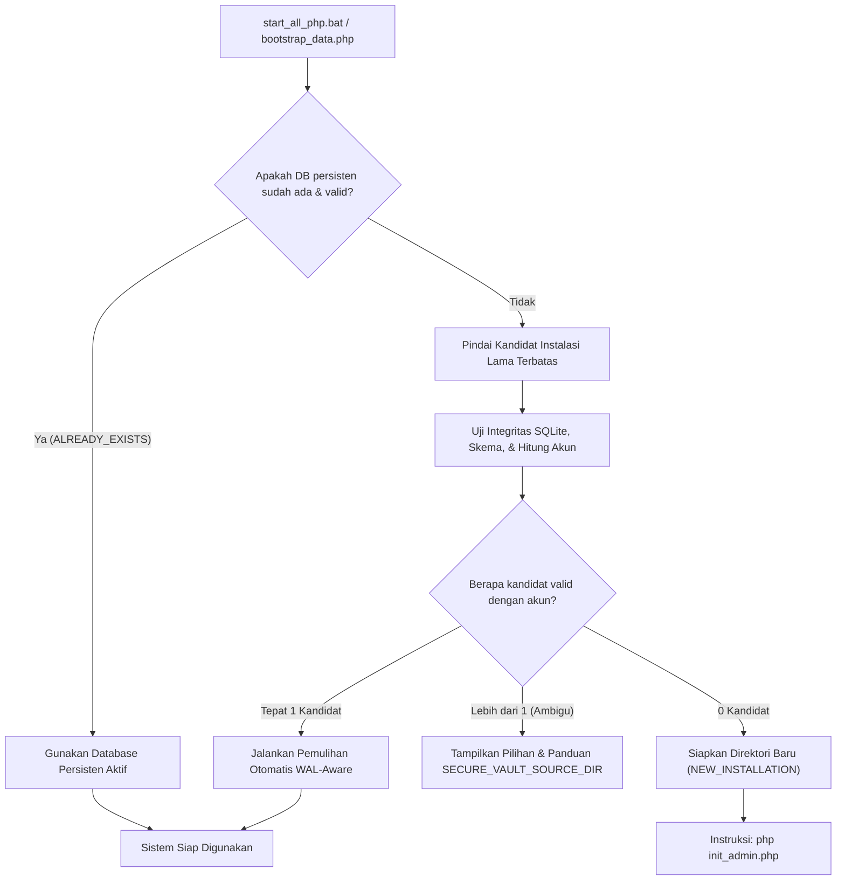

# DOKUMENTASI PERBAIKAN 4: PENYIMPANAN DATA PERSISTEN & PEMULIHAN OTOMATIS

## 1. Ringkasan Eksekutif & Latar Belakang Masalah

Sebelum Perbaikan 4, Secure Vault menyimpan seluruh data operasional di dalam direktori proyek (`PROJECT_DIR/var/secure-vault/`):
- Basis data SQLite (`var/secure-vault/data/secure-vault.sqlite`)
- Kunci rahasia lokal (`var/secure-vault/secrets.php`)
- Berkas chunk terenkripsi (`var/secure-vault/storage/`)
- Konfigurasi SMTP (`var/secure-vault/smtp.json`)
- Token tantangan MFA (`var/secure-vault/data/mfa_tokens.json`)

Ketika pengguna mengunduh pembaruan rilis dalam bentuk berkas ZIP dari GitHub dan mengekstraknya ke folder baru, folder ekstraksi baru tersebut tidak memiliki direktori `var/`. Akibatnya:
1. Skrip inisialisasi membuat basis data kosong baru dan menghasilkan `secrets.php` baru secara acak.
2. Akun pengguna, basis data vault, berkas terenkripsi, riwayat jejak audit, dan konfigurasi lokal hilang dari pandangan aplikasi.
3. Kunci enkripsi MFA yang berubah menyebabkan pengguna lama tidak dapat mendekripsi rahasia TOTP mereka.
4. Pengguna terpaksa memindahkan berkas secara manual atau melakukan migrasi teknis yang rumit dan berisiko merusak integritas sistem.

**Tujuan Perbaikan 4**: Menjadikan penyimpanan data operasional bersifat persisten per komputer/pengguna di luar direktori kode sumber, serta menyediakan mekanisme bootstrap otomatis yang mendeteksi dan memulihkan instalasi lama tanpa intervensi manual.

---

## 2. Arsitektur Penyimpanan Baru (Persistent Local Storage)

Sistem penyimpanan data Secure Vault kini dipisahkan secara permanen dari lokasi kode sumber proyek:

### A. Lokasi Standar Berdasarkan Sistem Operasi

| Sistem Operasi | Lokasi Standar Penyimpanan Persisten | Variabel Lingkungan Override |
| :--- | :--- | :--- |
| **Windows** | `%LOCALAPPDATA%\SecureVault\` (misal: `C:\Users\<User>\AppData\Local\SecureVault`) | `SECURE_VAULT_PERSISTENT_DIR` atau `SECURE_VAULT_HOME` |
| **macOS** | `~/Library/Application Support/SecureVault/` | `SECURE_VAULT_PERSISTENT_DIR` atau `SECURE_VAULT_HOME` |
| **Linux / Lainnya** | `~/.local/share/secure-vault/` (mengikuti standar `$XDG_DATA_HOME`) | `SECURE_VAULT_PERSISTENT_DIR` atau `SECURE_VAULT_HOME` |
| **Test Sandbox** | Jalur direktori isolasi sementara (`TemporaryDirectory`) | `SECURE_VAULT_DATA_DIR` & `SECURE_VAULT_STORAGE_DIR` |

### B. Struktur Hirarki Direktori Data Persisten

```text
%LOCALAPPDATA%\SecureVault\
├── secrets.php                 # Kunci JWT lokal & MFA_ENCRYPTION_KEY (0600)
├── smtp.json                   # Konfigurasi pengiriman email SMTP Gmail
├── recovery_receipt.json       # Bukti audit pemulihan instalasi sebelumnya
├── data\
│   ├── secure-vault.sqlite     # Basis data relasional SQLite operasional
│   ├── database.lock           # Kunci konkurensi SQLite runtime
│   └── mfa_tokens.json         # Token sesi tantangan MFA aktif
├── storage\
│   └── <file-uuid>\
│       ├── chunk_0.bin         # Chunk terenkripsi ciphertext AES-256-GCM
│       └── chunk_1.bin
├── backups\                    # Salinan cadangan SQLite berkala & pra-migrasi
└── audit-anchors\              # Dokumen checkpoint audit bertanda tangan
```

### C. Keamanan Web Root Isolation

Seluruh lokasi data persisten berada di luar direktori web root PHP (`backend_php/`). Aturan keamanan pada [config.php](file:///C:/Users/AXIOO/Documents/PKL/secure-vault-repo/backend_php/config.php) memverifikasi bahwa `realpath(PRIVATE_DIR)`, `realpath(DATA_DIR)`, dan `realpath(STORAGE_DIR)` tidak berada di bawah awalan `realpath(BASE_DIR)`. Pelanggaran terhadap isolasi ini akan langsung menggagalkan bootstrap aplikasi demi mencegah kebocoran data.

---

## 3. Mekanisme Bootstrap & Algoritma Deteksi Otomatis

Komponen inti [PersistentStorage.php](file:///C:/Users/AXIOO/Documents/PKL/secure-vault-repo/backend_php/utils/PersistentStorage.php) mengimplementasikan alur logika bootstrap 7 tahap sebelum aplikasi menerima permintaan HTTP:



### Ruang Lingkup Pemindaian Terbatas (Bounded Search)

Untuk mencegah pemindaian rekursif tak terbatas ke seluruh drive penyimpanan:
1. Memeriksa direktori `var/secure-vault` lokal proyek aktif.
2. Memeriksa direktori induk proyek (saudara folder proyek).
3. Memeriksa direktori kakek proyek (maksimal kedalaman 2 tingkat).
4. **Cakupan Lintas Folder Pengguna Windows (Cross-Folder Search)**:
   - `%USERPROFILE%\Documents`
   - `%USERPROFILE%\Desktop`
   - `%USERPROFILE%\Downloads`
   - `%OneDrive%\Documents` (jika aktif)
5. **Penyaringan & Keamanan Pencarian**:
   - Pemindaian dibatasi kedalaman maksimum 3 tingkat (`maxDepth = 3`).
   - Melewati symbolic links dan NTFS junction points (`is_link()`) untuk mencegah recursion loops.
   - Menggunakan daftar nama folder potensial (`secure`, `vault`, `pkl`, `project`, `code`, `app`, `install`, `download`, `repo`, `backup`, `var`, `data`).
   - Batas maksimum direktori yang dikunjungi adalah 250 direktori dan maksimal 20 kandidat berkas SQLite.
   - Jalur sistem seperti `sys_get_temp_dir()` atau akar drive (`C:\`) dikecualikan dari pemindaian.

---

## 4. Prosedur Pemulihan WAL-Aware & Integritas Data

Saat tepat satu kandidat instalasi lama ditemukan:
1. **Checkpointing WAL**: Menjalankan `PRAGMA wal_checkpoint(TRUNCATE)` pada basis data sumber untuk menyatukan seluruh transaksi WAL yang masih tertunda ke dalam berkas utama.
2. **Atomic Snapshot (`VACUUM INTO`)**: Menggunakan SQLite API `VACUUM INTO` untuk membuat salinan atomik, terdefragmentasi, dan konsisten ke berkas penampung sementara (`.recovering`).
3. **Verifikasi Integritas Pasca-Salin**: Menjalankan `PRAGMA integrity_check` dan pemeriksaan tabel relasional pada berkas sementara. Jika gagal, berkas sementara dihapus seketika tanpa menyentuh data target.
4. **Pemindahan Atomik**: Mengganti nama berkas sementara ke `secure-vault.sqlite` secara atomik dengan izin berkas `0600`.
5. **Pemulihan Kunci Rahasia**: Menyalin berkas `secrets.php` sumber agar `MFA_ENCRYPTION_KEY` dan `JWT_SECRET` lama tetap sinkron.
6. **Pemulihan Storage Berkas**: Menyalin seluruh direktori chunk terenkripsi dari folder `storage/` lama ke direktori `storage/` persisten.
7. **Pencatatan Bukti Pemulihan**: Menulis ringkasan pemulihan ke `recovery_receipt.json`.
8. **Retensi Sumber Asli**: Folder sumber lama **tidak dihapus** melainkan dipertahankan sebagai cadangan historis sekunder.

---

## 5. Inisialisasi Administrator Aman (Instalasi Baru)

Untuk komputer yang benar-benar belum pernah memiliki instalasi Secure Vault sebelumnya:
- Sistem **tidak menyediakan akun default** (seperti `admin/admin123`).
- Pendaftaran publik tetap **dinonaktifkan** demi keamanan Zero-Trust.
- Skrip khusus [init_admin.php](file:///C:/Users/AXIOO/Documents/PKL/secure-vault-repo/backend_php/scripts/init_admin.php) disediakan:
  - Hanya dapat dijalankan jika jumlah akun pada basis data adalah tepat **0 (nol)**.
  - Memvalidasi username alfanumerik (3–32 karakter).
  - Memvalidasi alamat email pengelola.
  - Menolak password umum / lemah, mewajibkan panjang minimal 12 karakter.
  - Menghasilkan hash password resmi Argon2id.
  - Menghasilkan entri audit trail `ADMIN_INITIAL_SETUP` berantai SHA3-512 V3.
  - Setelah administrator pertama dibuat, mekanisme setup ini **dinonaktifkan secara permanen**.

---

## 6. Berkas yang Dimodifikasi dan Ditambahkan

| No | Berkas | Tipe | Peran & Modifikasi |
| :--- | :--- | :--- | :--- |
| 1 | [PersistentStorage.php](file:///C:/Users/AXIOO/Documents/PKL/secure-vault-repo/backend_php/utils/PersistentStorage.php) | **New** | Modul inti resolusi direktori persisten, bounded candidate scanner, validasi SQLite, dan pemulihan WAL-aware. |
| 2 | [bootstrap_data.php](file:///C:/Users/AXIOO/Documents/PKL/secure-vault-repo/backend_php/scripts/bootstrap_data.php) | **New** | Skrip CLI pre-flight bootstrap otomatis yang dipanggil saat aplikasi dinyalakan. |
| 3 | [init_admin.php](file:///C:/Users/AXIOO/Documents/PKL/secure-vault-repo/backend_php/scripts/init_admin.php) | **New** | Mekanisme pembuatan administrator awal yang aman khusus instalasi baru bersih (hanya aktif jika user = 0). |
| 4 | [config.php](file:///C:/Users/AXIOO/Documents/PKL/secure-vault-repo/backend_php/config.php) | **Modified** | Menggunakan `PersistentStorage::resolvePersistentDirectory()`, isolasi web root, pembuatan otomatis secrets lokal jika belum ada. |
| 5 | [Database.php](file:///C:/Users/AXIOO/Documents/PKL/secure-vault-repo/backend_php/db/Database.php) | **Modified** | Memanggil fallback `PersistentStorage::bootstrap()` pada konstruktor jika berkas DB belum terbentuk. |
| 6 | [init_local_secrets.php](file:///C:/Users/AXIOO/Documents/PKL/secure-vault-repo/backend_php/scripts/init_local_secrets.php) | **Modified** | Menyesuaikan penyimpanan rahasia ke direktori persisten lokal. |
| 7 | [configure_gmail_smtp.ps1](file:///C:/Users/AXIOO/Documents/PKL/secure-vault-repo/configure_gmail_smtp.ps1) | **Modified** | Menyimpan konfigurasi `smtp.json` ke direktori persisten lokal. |
| 8 | [start_all_php.bat](file:///C:/Users/AXIOO/Documents/PKL/secure-vault-repo/start_all_php.bat) | **Modified** | Memanggil `bootstrap_data.php` pada langkah pertama peluncuran sistem. |
| 9 | [persistent_storage_recovery_test.php](file:///C:/Users/AXIOO/Documents/PKL/secure-vault-repo/backend_php/tests/persistent_storage_recovery_test.php) | **New** | Test suite otomatis yang menguji 14 skenario ketat pemulihan data, penanganan kegagalan mid-process, dan initial setup (33 assertions). |
| 10 | [legacy_structure_simulation_test.php](file:///C:/Users/AXIOO/Documents/PKL/secure-vault-repo/backend_php/tests/legacy_structure_simulation_test.php) | **New** | Test suite khusus verifikasi struktur instalasi historis commit `bd43a46`, simulasi lintas folder Documents ke Downloads, dan proteksi kegagalan tanpa fallback kosong (40 checks). |

---

## 7. Kompatibilitas Struktur Historis (Commit bd43a46)

Verifikasi mendalam terhadap kode sumber commit dasar `bd43a46` menunjukkan lokasi path asli instalasi lama:
- `STORAGE_DIR`: `<project_root>/var/secure-vault/storage` (terverifikasi langsung dari `config.php` commit `bd43a46`).
- `DATA_DIR`: `<project_root>/var/secure-vault/data`
- `DB_FILE`: `<project_root>/var/secure-vault/data/secure-vault.sqlite`
- `secrets.php`: `<project_root>/var/secure-vault/secrets.php`
- `smtp.json`: `<project_root>/var/secure-vault/smtp.json`

Sistem pemulihan pada [PersistentStorage.php](file:///C:/Users/AXIOO/Documents/PKL/secure-vault-repo/backend_php/utils/PersistentStorage.php) telah dirancang untuk mencakup seluruh lokasi historis asli tersebut serta variasi potensial lainnya (`var/secure-vault/data/files/`, `backend_php/storage/`, `data/storage/`).

### Proteksi Kegagalan Tanpa Fallback Kosong (*Strict Failure Safety*)
1. Jika database mencatat `chunk_count > 0` namun storage fisik tidak ditemukan atau kosong, pemulihan digagalkan secara aman (`STATUS_ERROR`) dan rollback database sementara dilakukan.
2. Jika database mencatat `user_count > 0` namun `secrets.php` hilang, pemulihan digagalkan secara aman untuk mencegah pembuatan kunci baru yang akan merusak dekripsi MFA pengguna lama.
3. [Database.php](file:///C:/Users/AXIOO/Documents/PKL/secure-vault-repo/backend_php/db/Database.php) secara tegas melempar `RuntimeException` jika bootstrap menghasilkan `STATUS_AMBIGUOUS_CANDIDATES` atau `STATUS_ERROR`, sehingga aplikasi tidak akan pernah membuat database baru kosong secara diam-diam saat pemulihan data lama tertunda atau gagal.

---

## 8. Hasil Pengujian Otomatis

Pengujian dijalankan pada lingkungan terisolasi dengan hasil sebagai berikut:

- `persistent_storage_recovery_test.php`: **33 / 33 ASSERTIONS PASSED (Exit Code 0)**
- `legacy_structure_simulation_test.php`: **40 / 40 CHECKS PASSED (Exit Code 0)**

Seluruh 9 test suite terdahulu juga telah diuji ulang dan menghasilkan status **100% PASS (Exit Code 0)**.
